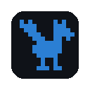

# roost bridge — the Chrome extension



**roost bridge lets a Claude running in roost see and use the Chrome on your
own computer.**

roost runs Claude on a server — a VM, a box under the desk, a container. That
Claude can edit code and run commands, but it cannot look at a web page: the
browser it would need is on your laptop, with your logins, behind your
network. This extension is the way across. With it, Claude in a roost
terminal can:

- check the page it just changed, in a real browser — screenshot it, read
  its console, click through it;
- look something up on a site only you are logged into — an admin panel, a
  dashboard, a store account, a ticket;
- fill in a form or walk a flow you would otherwise do by hand, while you
  watch;

and you can send it a page, a selection or a screenshot from any tab with a
right-click.

It is **not** a headless browser and not a sandbox. Claude acts in *your*
Chrome, as *you*. That is the whole point, and it is why the extension asks
before every new Claude session, refuses some pages outright, and shows you
everything it opens. Design and threat model:
[docs/superpowers/specs/2026-10-12-browser-bridge-design.md](../docs/superpowers/specs/2026-10-12-browser-bridge-design.md).

## How it works

```
Claude ─ stdio ─ roost mcp ─ socket ─ roost server ─ websocket ─ roost tab ─ extension ─ your tabs
 (server)                                                        (your Chrome)
```

`roost mcp` gives Claude its `chrome_*` tools. A call travels to the roost
server, which signs it with a key only it and the extension know, and hands
it to the roost page you have open. That page is only a relay: the extension
checks the signature, checks that you allowed this Claude, checks the target
page is not off-limits, and then drives the tab through Chrome's DevTools
protocol. No port is opened on your laptop, and nothing reaches your browser
unless a roost tab is open in it.

## What Claude can do

| Tool | Does |
|---|---|
| `chrome_tabs` | lists your open tabs (pages it may not drive are shown as hidden) |
| `chrome_open` | opens a page in a new tab in its tab group, or navigates a given tab |
| `chrome_read` | the page's text, plus numbered links, buttons and inputs |
| `chrome_click` | a real mouse click on an element |
| `chrome_type` | types into an input or textarea, replacing what it holds, optionally pressing Enter |
| `chrome_screenshot` | an image of the visible part of the tab |
| `chrome_console` | console messages and uncaught errors |
| `chrome_click` x,y | clicks a point on the last screenshot, for what has no ref (a cross-origin iframe, a canvas) |
| `chrome_upload` | puts files from the roost host into a file input — the input itself, or a button that opens the picker (the picker is caught, no dialog appears) |
| `chrome_close` | closes a tab — **only** one this Claude session opened itself |
| `handoff_read` / `handoff_send` | the project's handoff page (below) |

What it cannot do, unsafe mode or not: touch `chrome://` and other browser
pages, the Chrome Web Store, roost itself, or any site on your *Never drive
these sites* list; close a tab you opened; read files on your computer; or
act at all without an open roost tab.

## Setup, once

1. **Give Claude the tools.** On the roost host:

   ```sh
   claude mcp add -s user roost -- roost mcp
   ```

   roost never registers this itself. Claude sessions started after this
   have the `chrome_*` and `handoff_*` tools; a session already running needs
   `/mcp` → *roost* → *Reconnect*.

2. **Install the extension.** In Chrome, from the
   [Chrome Web Store](https://chromewebstore.google.com/detail/roost-bridge/kpnmhpeghnakadgjgdihmmfjcmbfdlca).
   In Firefox, see [Firefox](#firefox) below. Or load it unpacked: download `roost-extension-<version>.zip` from the
   [release](https://github.com/PeterKnego/roost/releases) matching your
   roost, and unzip it where it can stay. In Chrome, open
   `chrome://extensions`, turn on *Developer mode*, choose *Load unpacked* and
   pick the `roost-extension` folder. From a checkout, this `extension/`
   directory works the same way.

3. **Pair it.** On the roost host, run `roost browser-key` (with the same
   `ROOST_STATE_DIR` as the roost you use — each roost instance has its own
   key). In the extension's options (right-click its toolbar icon →
   *Options*), paste the key, then add your roost address, e.g.
   `https://roost.example.com` or `http://127.0.0.1:8444`. Chrome asks you to
   allow access to that address.

4. **Open roost** in a tab, or reload it. That tab relays calls.

## Firefox

The same extension runs in Firefox 140 and later, with the same tools,
consent window, key, deny-list and handoff. Install it from
`roost-extension-<version>-firefox.zip` on the release page: from
addons.mozilla.org once it is listed, or for a quick try, in
`about:debugging` → *This Firefox* → *Load Temporary Add-on…*, picking that
zip (a temporary add-on is gone when Firefox restarts).

Firefox has no debugger API, so roost bridge drives pages differently there,
and three things follow from it:

- **It needs access to websites.** Firefox runs roost bridge's reads, clicks
  and typing as scripts in the page and screenshots with `tabs.captureTab`,
  and both need the optional *access to all websites*. The first consent
  window's Allow asks for it; so does *Access to websites* in the options.
  Each Claude session still asks you before it does anything.
- **Clicks and typing are dispatched events.** Pages take them as normal,
  except a page that checks whether an event came from a real person
  (`isTrusted`). Claude's result says so when it was in Firefox.
- **A button that opens a file picker cannot be caught.** `chrome_upload`
  needs the `<input type=file>` itself; Claude's error says so. Console
  messages are collected from the first `chrome_console` on, for each page
  load, so the first moments of a load can be missed.

Firefox match patterns take no port, so a roost at `http://127.0.0.1:8444`
is granted as `http://127.0.0.1/*`. The extension still checks the full
address, port included, before it acts on anything.

## Using it

**The first call from each Claude session asks you.** A small window names
the roost address, the project, the terminal and the Claude process, and
shows what it wants to do:

- **Allow for this Claude session** — until that Claude exits, Chrome
  restarts, or you revoke it in the toolbar popup;
- **Allow once**;
- **Deny** — also what happens after 2 minutes with no answer.

**You can watch.** Pages Claude opens go into an orange tab group in the
window you used last, named after the roost project — `roost - karpie`, or
`roost - roost - fix-login` for a worktree — and come to the front as they
open. To keep them behind your own tab instead, turn off *Bring Claude's tabs
to the front* in the options; a screenshot then brings a tab forward only for
a moment. While Claude works in a tab, Chrome shows its "is debugging this
browser" bar; *Cancel* there detaches it at once.

**You stay in charge of what matters.** Claude can put things in a cart or
fill in a form; whether to press *Buy* or *Submit* on something that costs
money or cannot be undone is a question for you, and a well-behaved Claude
asks. The extension cannot tell a purchase from a search, so for sites where
you never want it to act at all, use *Never drive these sites*.

**Unsafe mode** in the options allows every call from every roost Claude with
no prompt. The toolbar badge reads **!!** while it is on. It exists for
throwaway browser profiles; do not turn it on in the Chrome you bank in.

## Sending to Claude

Right-click any page:

- *Send page to roost Claude*
- *Send selection to roost Claude*
- *Send screenshot to roost Claude*

It goes to the roost tab you used last and is pasted into that project's
Claude terminal, the same as the tree's *Send to Claude*. Nothing is
submitted. The toolbar badge flashes **ok** or **no**.

## Handoff with Claude in Chrome

Each project has a plain message page at `/frag/<project>/handoff`. Point
Claude in Chrome (or yourself) at it. The roost Claude reads it with
`handoff_read`, which can wait for a reply, and answers with `handoff_send`.
Treat what arrives there as untrusted: a web page can steer what a browser
agent writes.

## Updating

Unzip the new release **over the same folder** and press ↻ on the extension
in `chrome://extensions`, then reload your roost tabs. Chrome identifies an
unpacked extension by its folder, so a new folder is a new extension with
empty settings — the key and roost addresses would have to be entered again.
Reloading the extension also forgets this browser session's grants and which
tabs each Claude opened, so each Claude asks once more, and tabs from before
the reload have to be closed by hand.

## When something does not work

| Claude sees | Meaning and fix |
|---|---|
| `no roost tab with the roost browser extension is open` | Open roost in Chrome, or reload its tab — after updating the extension, always. |
| `the roost extension has no key` | Run `roost browser-key` on the roost host and paste it into the options. |
| `the call's signature does not match this extension's key` | The key belongs to a different roost instance, or was rotated. Paste the current one. |
| `the user did not allow this in the browser` | The consent window was denied, closed, or left for 2 minutes. |
| `that is a roost tab` / `… is on your deny-list` / `… pages are never driven` | The page is off-limits by design. |
| `tab … was not opened by this session` | `chrome_close` only closes tabs that Claude session opened. |
| `Firefox has not given roost bridge access to websites` | Allow it in the next consent window, or in the options under *Access to websites*. |
| No `chrome_*` tools at all | `claude mcp add` (step 1) is missing, or the session predates it: `/mcp` → *roost* → *Reconnect*. |

## Rotating the key

Delete `state/hook/browser.key` in roost's state directory, run
`roost browser-key` again, and paste the new key into every browser.
